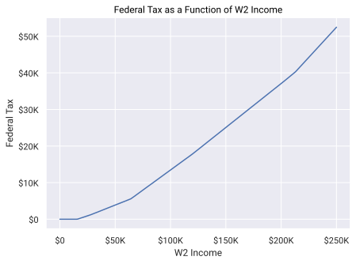
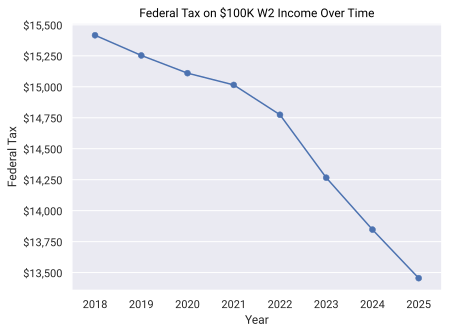
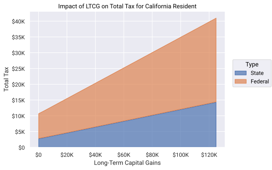
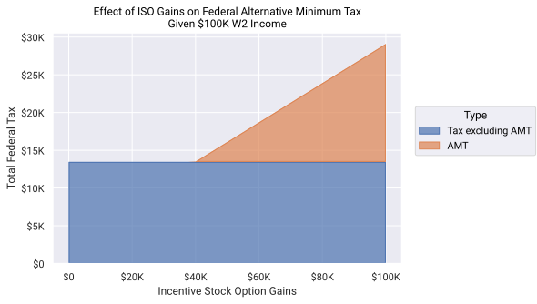

# tenforty

[](https://github.com/mmacpherson/tenforty/actions/workflows/ci.yml)
[](https://results.pre-commit.ci/latest/github/mmacpherson/tenforty/main)

[](https://pypi.org/project/tenforty/)
[](https://pypi.org/project/tenforty/)
[](https://pypi.org/project/tenforty/)

[](https://github.com/mmacpherson/tenforty/blob/main/LICENSE.txt)
[](https://pypi.org/project/tenforty/)
[](https://github.com/astral-sh/uv)
[](https://github.com/astral-sh/ruff)


## Overview

`tenforty` is an open-source Python package designed to help demystify US
federal and state tax computations. It offers an accessible way to explore tax
scenarios, compare different tax situations, and understand how the inputs to a
return affect what you owe. It's particularly useful for sensitivity analysis,
what-if sweeps, and optimizing your taxes.

The package is built on top of
[Open Tax Solver](https://opentaxsolver.sourceforge.net/) (OTS) and tenforty's own
graph backend, wrapping them into a Python library. Returns are computed on
OTS by default when its extension is installed; graph-only installs use auto
routing by default (see
[Which backend computes your return](#which-backend-computes-your-return)). The
ideas behind it are discussed in a blog post
[here](https://finedataproducts.com/posts/2024-03-10-tax-scenarios-with-ai/).

You can try `tenforty` out immediately in your browser via the included Colab
notebook: [](https://colab.research.google.com/github/mmacpherson/tenforty/blob/main/notebooks/tenforty_Package_Demo.ipynb)


## Features

- Compute US federal taxes and state taxes, back to the 2018 tax year.
- Explore how taxes vary as a function of income, state, filing status, and year.
- Evaluate "what if" tax scenarios efficiently and reproducibly, with results in
  a `polars` dataframe.
- Validated inputs with informative error messages, which make it a good
  tool-call target for a coding agent.


## Disclaimer

`tenforty` is an open-source tool intended for informational and educational
purposes only and does not provide tax advice. Known limitations are detailed
in the [Limitations](#known-limitations) section below.


## Installation

```sh
pip install tenforty
```

Python 3.10–3.15 is supported on Linux, macOS and Windows.

**On Windows, tenforty has the graph backend only.** OTS crashes when built
for Windows, so Windows wheels leave it out; the
[Windows build research](./docs/windows-build-research.md) has the details.

A call that names no backend follows `backend="auto"` on Windows: supported
2024–2025 federal-only returns and in-scope state returns compute on graph
without a backend argument.

- **What computes:** the returns that `backend="auto"` routes to graph on
  other platforms (see
  [Which Backend Computes Your Return](#which-backend-computes-your-return)).
  Graph scope, supported inputs and required state facts apply on Windows too;
  an explicit `backend="graph"` outside validated state scope requires
  `allow_unvalidated=True`.
- **What refuses:** a valid route needing OTS raises `BackendUnavailableError`
  before computing, under every `on_error` policy. Examples include 2018–2023
  returns, CA returns that `auto` keeps on OTS, an explicit `backend="ots"`
  for a supported OTS return, and `tenforty.core.evaluate_form`.
  Routing refusals happen first: Michigan returns under `auto` and an explicit
  `backend="ots"` for Illinois raise `UnsupportedReturnError`, as does an
  explicit graph request outside validated state scope without opt-in.
  Required-fact and unsupported-input checks can raise `UnsupportedInputError`
  too.
- **The examples below:** five need OTS, as checked by the graph-only README
  test. The Quick Start, the tax table and the capital-gains plot are CA
  returns, the federal-tax-over-time plot spans 2018–2025, and
  [The Graph Backend](#the-graph-backend) compares against `backend="ots"`.
  A 2024–2025 example using a federal-only return or a validated state such
  as `state="IL"` needs no backend argument on Windows; the explicit OTS
  comparison still requires an install with OTS.

### Graph-only installations

When the compiled OTS extension is absent (a `TENFORTY_GRAPH_ONLY=1` build,
including Windows builds), omitting `backend` uses `"auto"`. A bare call such as
`tenforty.evaluate_return(year=2025, w2_income=75_000)` computes on graph without
an extra backend argument. This applies to `evaluate_return`, `evaluate_returns`
and `tenforty.backends.get_backend`.

The same graph scope, input restrictions and required state facts apply as for
an explicit `backend="auto"`. A valid route needing unavailable OTS raises
`BackendUnavailableError`; routing/input refusals can occur first. Explicit
backends keep their meaning, including an explicit `backend="ots"`. Installs
with OTS retain the OTS default. The same bare call, where both installs
support it, computes on OTS on a full install and graph on a graph-only install,
so results can differ between platforms wherever the engines differ; see
[Migrating between backends](./docs/migrating-to-graph-default.md).

### Building from source

`pip install tenforty` uses a prebuilt wheel where one matches your platform:
CPython 3.10–3.15 on Linux x86_64 and aarch64 (glibc 2.28+ and musl), on
macOS arm64 and x86_64, and on Windows x86_64 (graph only).
Elsewhere it builds from the source distribution, and that build needs a
[Rust toolchain](https://rustup.rs) as well as a C++ compiler, because the graph
backend is compiled from Rust. Without Rust the build stops and explains why;
it no longer installs a package that lacks the graph backend.

Requiring Rust for a source build is an intermediate measure. The long-term
answer is a prebuilt wheel for every platform, so that building from source is
only the fallback for platforms without one.

To build the legacy OTS-only package instead, without Rust, set
`TENFORTY_WITHOUT_GRAPH=1`:

```sh
TENFORTY_WITHOUT_GRAPH=1 pip install tenforty
```

That package has no graph backend: `backend="ots"` works, and any return routed
to the graph backend raises an error instead of falling back to OTS.


## Which Backend Computes Your Return

**With OTS installed, the default is OTS** (`backend="ots"`): every return is computed on OTS,
federal returns for 2018–2025, and for 2024–2025 the states AZ, CA, MA, MI, NC,
NJ, NY, OH, OR, PA and VA, plus the states without an income tax (earlier years
have fewer states; see the Colab demo's table). Any other state raises
`UnsupportedReturnError` before computing, naming the graph alternative where
there is one. In 2025.14 OTS also refuses what it would compute wrongly:
every Michigan return, and the
[state inputs its maps do not yet deliver](./docs/migrating-to-graph-default.md#ots-refuses-state-inputs-its-maps-do-not-deliver).

**On full installs the graph backend is opt-in** (`backend="graph"` or
`backend="auto"`); graph-only installs use the `"auto"` column below by default. It is
incomplete, and so far validated for 2024 and 2025 federal-only returns and for
IL, MS and OR plus the eight states without an income tax (AK, FL, NV, SD, TN,
TX, WA and WY). Other states refuse unless you pass `allow_unvalidated=True`,
because they aren't validated yet; the work to validate them is
[tenforty-s48h](#graph-coverage).

| Return | `backend="auto"` | `backend="graph"` |
|---|---|---|
| Tax years 2018–2023 | OTS, for the states OTS has that year; any other state raises | Raises `UnsupportedReturnError` |
| 2024–2025, federal only (`state=None`) | Graph | Graph |
| 2024–2025 in IL, MS or OR, or a state without an income tax (AK, FL, NV, SD, TN, TX, WA, WY) | Graph | Graph |
| 2024–2025 in AZ, CA, MA, NC, NJ, NY, OH, PA or VA | OTS | Raises, naming the reasons, unless `allow_unvalidated=True` |
| 2024–2025 in MI | Raises: OTS Michigan applies no personal exemption, and graph MI is not validated | Raises, naming the reasons, unless `allow_unvalidated=True` |
| 2024–2025 in AL, AR, CO, CT, DC, DE, GA, HI, IA, ID, IN, KS, KY, LA, MD, ME, MN, MO, MT, ND, NE, NH, NM, OK, RI, SC, UT, VT, WI or WV | Raises, naming the reasons | Raises, naming the reasons, unless `allow_unvalidated=True` |

- <a id="graph-coverage"></a>**Graph coverage.** Graph has forms for every
  state, but a 2024–2025 state is validated, and in graph scope, only when its
  known graph-side defects are closed and official values support it. The other
  states stay out for a named reason: an open defect, missing evidence, or a
  decision. [Graph state scope](./docs/error-handling.md#graph-state-scope-under-auto)
  has the reasons. MD, ME and NC wait on the itemized-deduction contract
  (`tenforty-nuc6`). Ohio stays out by decision: graph Ohio Married/Joint
  requires the joint-credit [state fact](./docs/state-facts.md), which has no
  default, and since OTS already computes Ohio, routing it to graph would make
  calls that work today raise. Mississippi, which OTS doesn't cover, requires
  its facts instead of being unavailable.
- **Outside graph scope, graph refuses unless asked.** `backend="graph"` on a
  state outside graph scope raises `UnsupportedReturnError` before computing,
  naming the reasons, because the graph is not yet validated there and its
  figure may be wrong (graph California, for one, does not yet apply the
  dependent exemption credit, `tenforty-b72.54`). Pass
  `allow_unvalidated=True` to compute it on the graph backend anyway. The same
  rule applies to `evaluate_returns` (one such row refuses the whole batch),
  `marginal_rate`, `marginal_rates` and `solve_for_income`. It never affects
  `"ots"` or `"auto"`.
- **Mississippi needs facts.** MS is in graph scope, conditional on
  [state facts](./docs/state-facts.md) with no default. A Married/Joint return
  needs both spouses' actual Mississippi AGIs,
  `state_facts.MS(taxpayer_adjusted_gross_income=..., spouse_adjusted_gross_income=...)`;
  a Widow(er) return needs `MS(head_of_family_eligible=...)` (Head_of_House
  defaults to the documented resident-dependent baseline). Without them the
  call raises `UnsupportedInputError` before computing. MS Married/Joint
  state and total-tax derivatives and solves over household income are
  unsupported, and a nonzero `schedule_1_income`, `state_adjustment`,
  `dependent_exemptions`, `itemized_deductions`, `state_and_local_taxes` or
  `federal_itemized` regular-tax amount is refused for MS: itemizing on MS is
  not supported through either itemized input.
- **The earned income credit needs facts.** `eitc_eligible=False` gives a
  determined 0, with no child count needed. `eitc_eligible=True` with
  `num_eitc_children` computes the credit. Otherwise it is `None` (not
  determined), and graph Missouri returns raise; `eitc_eligible=False` is
  accepted there. OTS always reports `None`.
- **Under `"auto"`, OTS is chosen by coverage, not as a retry.** A state goes
  to OTS because it is outside graph scope and OTS computes it. A return that
  fails on the graph backend is not rerun on OTS.
- **An explicit backend is never reinterpreted.** `backend="ots"` computes on
  OTS and `backend="graph"` on graph, or the call raises before computing.
  The OTS default gives the results of releases before 2025.13, but not every
  earlier contract: the deduction election, the frame schema and the error
  behavior changed for both backends. See
  [Migrating between backends](./docs/migrating-to-graph-default.md).
- **The OTS-only package** (`TENFORTY_WITHOUT_GRAPH=1`) has no graph backend, so
  a return routed to graph raises `BackendUnavailableError` there.


## Quick Start

The `evaluate_return` function computes the outputs for a single tax return
given some inputs:

``` python
from tenforty import evaluate_return

evaluate_return(
    w2_income=100_000, state="CA", filing_status="Married/Joint", num_dependents=2
).model_dump()
```

This results in the following:

<!-- readme-output: value -->
``` python
{'total_tax': 4476.0,
 'federal_adjusted_gross_income': 100000.0,
 'federal_effective_tax_rate': 4.884671532846715,
 'federal_tax_bracket': 12.0,
 'federal_taxable_income': 68500.0,
 'federal_qbi_deduction': 0.0,
 'federal_amt': 0.0,
 'federal_income_tax': 3346.0,
 'federal_se_tax': 0.0,
 'federal_niit': 0.0,
 'federal_additional_medicare_tax': 0.0,
 'federal_child_tax_credit': 4400.0,
 'federal_earned_income_credit': None,
 'federal_total_tax': 3346.0,
 'state_adjusted_gross_income': 100000.0,
 'state_taxable_income': 88588.0,
 'state_total_tax': 1130.0,
 'state_tax_bracket': 6.0,
 'state_effective_tax_rate': 1.2755677969928207,
 'assumptions': ()}
```

No `year=` argument was specified here, so the default year, 2025, was used,
and no `backend=`, so on the full install used here it was computed on OTS. The
output is a pydantic model, and we've called its `.model_dump()` method to
show the result as a dictionary. Every argument and output field is listed in
the [API Reference](#api-reference).


## Previewing Your Own Return with a Coding Agent

The most practical way to use `tenforty` on your own taxes today is to let a
coding agent drive it, such as [Claude Code](https://claude.com/claude-code),
[Codex](https://github.com/openai/codex), or an open-source agent like
[pi](https://github.com/badlogic/pi-mono) or [OpenCode](https://opencode.ai).
You describe your situation in plain language, and the agent maps your
figures onto `tenforty`'s inputs, runs the return, and answers follow-up
questions by changing inputs and re-running.

How much to trust the result depends on what your return contains. The
[evidence summary](./docs/evidence-summary.md) says, for each kind of return,
what is checked against independent published values and
what is only checked for agreement between the backends, against snapshots, or
by property tests. Tax-Calculator serves as an independent federal model
([differential audit](./docs/taxcalc-differential-audit.md)). It's still a
**preview**, not a filing: nothing is guaranteed, and the usual way it goes wrong is a figure from
your documents that the agent maps to the wrong input or that `tenforty`
doesn't model (see the [API Reference](#api-reference) and
[Known Limitations](#known-limitations)). It's well suited to "what will I owe,
and why?" and "what happens if I sell this stock in December?" before you file
with your usual software or preparer, and to cross-checking that software
afterwards.

**1. Decide where your data goes.** Your return is about as sensitive as
personal data gets, and everything you tell the agent is sent to whichever
model provider it uses. That's a choice worth making deliberately, and it's
yours to make:

- If you use a hosted agent from Anthropic, OpenAI, or another provider, read
  that provider's data-retention and training policies for the plan you're on.
- Open-source agents such as pi and OpenCode can point at other endpoints,
  including inference providers that offer zero data retention, such as
  [DeepInfra](https://docs.deepinfra.com/account/data-privacy) or
  [Together AI](https://docs.together.ai/docs/zero-data-retention). Check
  their current terms yourself.
- For the most privacy, run a model locally with a tool like
  [llama.cpp](https://github.com/ggml-org/llama.cpp),
  [Ollama](https://ollama.com), or [LM Studio](https://lmstudio.ai), so nothing
  leaves your machine.

**2. Consider giving it numbers, not documents.** Transcribing the figures you
need (W-2 box 1, 1099-INT and 1099-DIV totals, net short- and long-term gains,
and so on) shares far less than scans that carry your SSN and account numbers.

**3. Work in a scratch directory** and let the agent install `tenforty` there:

```sh
mkdir tax-preview && cd tax-preview
uv venv && uv pip install tenforty
```

**4. Ask, and ask for the mapping back.** For example:

> Use the `tenforty` Python package (read its README for the inputs) to
> estimate my 2025 federal and California taxes. Married filing jointly, two
> kids. W-2 box 1: $182,400 and $64,100. 1099-INT: $1,150. 1099-DIV: $3,200
> ordinary, $2,600 qualified. Long-term gains: $12,000. Before running anything,
> show me how you mapped each of my figures to a `tenforty` input, and list
> anything I gave you that `tenforty` can't represent.

The last instruction matters most. A figure the agent silently drops, or puts
in the wrong input, is the most likely way to get a confidently wrong answer.
One common trap: `ordinary_dividends` is the *total* (1099-DIV box 1a) and
already includes `qualified_dividends` (box 1b).

Once the baseline matches your expectations, the follow-ups are where the
package earns its keep: sweeps over a gain you
haven't realized yet, or how close you are to AMT.


## Examples

Here are some more examples of what you can do with `tenforty`:

### Creating Tax Tables: Federal/State Tax Brackets as a Function of W2 Income

The `evaluate_returns` method sweeps out a grid over any input arguments that
are provided as lists, allowing you to evaluate a wide array of tax scenarios.
Here we make a simple tax table by varying W2 income:

``` python
from tenforty import evaluate_returns

evaluate_returns(
    w2_income=list(range(50_000, 250_001, 50_000)),
    state="CA",
    filing_status="Married/Joint",
    num_dependents=2,
)[
    [
        "w2_income",
        "federal_effective_tax_rate",
        "federal_tax_bracket",
        "state_effective_tax_rate",
        "state_tax_bracket",
    ]
]
```

This results in a `polars.DataFrame` (use `.to_pandas()` if you need pandas
compatibility). The rates are percentages, shown here to two decimals. The
effective rates divide by taxable income:

<!-- readme-output: table -->
| w2_income | federal_effective_tax_rate | federal_tax_bracket | state_effective_tax_rate | state_tax_bracket |
|----------:|---------------------------:|--------------------:|-------------------------:|------------------:|
|     50000 |                       0.00 |                  10 |                     0.00 |                 2 |
|    100000 |                       4.88 |                  12 |                     1.28 |                 6 |
|    150000 |                       9.70 |                  22 |                     3.32 |                 8 |
|    200000 |                      13.35 |                  22 |                     4.86 |               9.3 |
|    250000 |                      15.44 |                  24 |                     5.79 |               9.3 |


### Plot: Federal Tax as a Function of W2 Income

Since the output is a dataframe, one may readily use any of numerous
visualization tools to make plots. The plots here use seaborn, which takes a
pandas frame, so they need `pip install seaborn pyarrow` and call
`.to_pandas()`. Here we revisit the example above, evaluating a wider range of
W2 incomes at finer resolution than before.

``` python
import seaborn.objects as so

df = evaluate_returns(w2_income=list(range(0, 250_001, 1_000)))

(
    so.Plot(df.to_pandas(), x="w2_income", y="total_tax")
    .add(so.Line())
    .label(
        x="W2 Income", y="Federal Tax", title="Federal Tax as a Function of W2 Income"
    )
)
```




### Plot: Federal Tax Over Time

One can just as easily vary the year as any other parameter. `tenforty`
supports back to the 2018 tax year, every year computed on OTS by default when
OTS is installed (its
authors have published an edition every year for over two decades). Here we
show the federal tax on
$100K of W2 income for each supported year.

``` python
import polars as pl

df = evaluate_returns(
    year=[2018, 2019, 2020, 2021, 2022, 2023, 2024, 2025], w2_income=100_000
).cast({"year": pl.Utf8})

(
    so.Plot(df.to_pandas(), x="year", y="total_tax")
    .add(so.Line())
    .add(so.Dot())
    .label(
        x="Year",
        y="Federal Tax",
        title="Federal Tax on $100K W2 Income Over Time",
    )
)
```



*This one's a little melodramatic because we don't make the y-axis go to zero;
it's only about a 3% drop over the years.*


### Plot: Impact of Long-Term Capital Gains

Both backends compute short- and long-term capital gains -- although, see the
[Limitations](#known-limitations) section below -- so you can ask questions about the impact on your taxes of selling some
appreciated stock this year, and show the breakdown between state and federal
taxes:

``` python
import polars as pl

df = (
    evaluate_returns(
        w2_income=75_000,
        state="CA",
        long_term_capital_gains=list(range(0, 125_001, 5000)),
    )
    .select(["long_term_capital_gains", "state_total_tax", "federal_total_tax"])
    .unpivot(index="long_term_capital_gains", variable_name="Type", value_name="tax")
    .with_columns(
        pl.col("Type").replace(
            {"state_total_tax": "State", "federal_total_tax": "Federal"}
        )
    )
)

(
    so.Plot(df.to_pandas(), x="long_term_capital_gains", y="tax", color="Type").add(
        so.Area(alpha=0.7), so.Stack()
    )
    .label(
        x="Long-Term Capital Gains",
        y="Total Tax",
        title="Impact of LTCG on Total Tax for California Resident",
    )
)
```




### Plot: Will I Incur Alternative Minimum Tax (AMT)?

Employees at tech companies are commonly issued incentive stock options, the
exercise of which can put them in a situation where they need to pay actual
money in taxes on paper gains, via the alternative minimum tax. With
`tenforty`'s help you can see it coming at least: ;)

`federal_total_tax` already includes the AMT, so the stack below splits it into
the tax excluding AMT and the AMT itself; the two layers sum to the total.


``` python
import polars as pl

df = (
    evaluate_returns(
        w2_income=100_000, incentive_stock_option_gains=list(range(0, 100_001, 2500))
    )
    .with_columns(
        excluding_amt=pl.col("federal_total_tax") - pl.col("federal_amt")
    )
    .select(["incentive_stock_option_gains", "excluding_amt", "federal_amt"])
    .unpivot(index="incentive_stock_option_gains", variable_name="Type", value_name="tax")
    .with_columns(
        pl.col("Type").replace(
            {"federal_amt": "AMT", "excluding_amt": "Tax excluding AMT"}
        )
    )
)

(
    so.Plot(df.to_pandas(), x="incentive_stock_option_gains", y="tax", color="Type")
    .add(so.Area(alpha=0.7), so.Stack())
    .label(
        x="Incentive Stock Option Gains",
        y="Total Federal Tax",
        title="Effect of ISO Gains on Federal Alternative Minimum Tax\nGiven $100K W2 Income",
    )
)
```




## API Reference

The two functions `evaluate_return` and `evaluate_returns` are the main
interface to `tenforty`. They take exactly the same arguments, except that any
of the arguments to `evaluate_returns` may either be a single value, or a list
of values. `evaluate_return` evaluates one single return, and
`evaluate_returns` evaluates all combinations of inputs subtended by the
provided values and collects the results into a dataframe.

The inputs to either function are validated, and if for example a filing status
is misspelled, you'll get an informative error message along with a list of the
valid options. [Error Handling](./docs/error-handling.md) describes the
`on_error` policies and exception types.

### Arguments

| Argument                     | Type                     | Default             | Notes                              |
|------------------------------|--------------------------|---------------------|------------------------------------|
| `year`                       | int                      | 2025                | 2018-2025 inclusive                |
| `state`                      | str \| None               | None                | Two-letter state code, or None for a federal-only return. OTS computes AZ, CA, MA, MI, NC, NJ, NY, OH, OR, PA, VA and the no-income-tax states, for the years it has them (2025.14 refuses MI on OTS). The graph backend has every state and DC for 2024-2025, and computes those outside graph scope only with `allow_unvalidated=True`: [Which backend computes your return](#which-backend-computes-your-return) |
| `filing_status`              | str                      | Single              | "Single", "Married/Joint", "Head_of_House", "Married/Sep", "Widow(er)" |
| `num_dependents`             | int                      | 0                   | Total dependents (qualifying children and qualifying relatives). Each gets the child tax credit or the $500 credit for other dependents; see `num_ctc_dependents`. Applied for 2023-2025 (OTS) and 2024-2025 (graph); OTS 2018-2022 applies neither. The refundable ACTC and dependent care are not modeled; the EITC is `federal_earned_income_credit` (see `num_eitc_children`). |
| `num_ctc_dependents`         | int \| None              | None                | Keyword-only. How many of `num_dependents` are child tax credit qualifying children (under 17, valid SSN; Schedule 8812 line 4). Unset means all of them. Set it lower for dependents who only get the $500 other-dependent credit: children 17+, dependents without an SSN, qualifying relatives. Must not exceed `num_dependents` |
| `dependent_exemptions`       | float                    | 0.0                 | State exemption dollars (not a count). A nonzero value is refused on OTS and under `backend="auto"` for every state and year; only an explicit `backend="graph"` with `allow_unvalidated=True` accepts it (these states are outside graph scope), for GA, HI, IN, KS, LA 2024, MD, ME, NJ, VA, VT and WV. See its docstring in `TaxReturnInput` for the per-state rules |
| `num_eitc_children`          | int \| None              | None                | Keyword-only. Earned income credit qualifying children (Schedule EIC; at most 3 count): under 19, a student under 24, or disabled, with a valid SSN, living with you over half the year, and not claimed for the EIC by anyone else. Never inferred from `num_dependents` or the child tax credit count (a noncustodial parent with a Form 8332 release gets the CTC, not the EIC). Graph only |
| `eitc_eligible`              | bool \| None             | None                | Keyword-only. You meet the EIC conditions the inputs cannot show: valid SSNs, citizen or resident alien all year, no Form 2555, not another taxpayer's qualifying child, not barred after a disallowance; with no qualifying child also all of Pub 596 Rule 11 (one person, you or a joint spouse, at least 25 and under 65 at year end, by Rule 11's birth-date bounds), nobody's dependent or qualifying child, U.S. home over half the year. `filer_65_or_older`/`spouse_65_or_older` never affect the EIC. `False`: the credit is 0. `True` with `num_eitc_children`: computed. Otherwise `federal_earned_income_credit` is `None` (not determined). Graph Missouri returns, and derivatives or solves of an output that reads the EIC, require these facts. Graph only |
| `standard_or_itemized`       | str                      | Auto                | Federal deduction election: "Auto" takes the larger; "Standard" or "Itemized" forces that choice ([contract](docs/deduction-choice-contract.md)) |
| `w2_income`                  | float                    | 0.0                 |                                    |
| `taxable_interest`           | float                    | 0.0                 |                                    |
| `tax_exempt_interest`        | float                    | 0.0                 | Keyword-only. Form 1040 line 2a. Not taxed; counts toward the EIC investment income limit. Graph only |
| `qualified_dividends`        | float                    | 0.0                 |                                    |
| `ordinary_dividends`         | float                    | 0.0                 | Total ordinary dividends, including qualified |
| `short_term_capital_gains`   | float                    | 0.0                 |                                    |
| `long_term_capital_gains`    | float                    | 0.0                 |                                    |
| `self_employment_income`     | float                    | 0.0                 | Schedule C profit used by Schedule SE and QBI |
| `qbi_w2_wages`               | float                    | 0.0                 | W-2 wages paid by the QBI business or aggregation |
| `qbi_ubia`                   | float                    | 0.0                 | UBIA of qualified property for that business or aggregation |
| `qbi_is_sstb`                | bool                     | False               | Whether that business or aggregation is an SSTB |
| `rental_income`              | float                    | 0.0                 |                                    |
| `schedule_1_income`          | float                    | 0.0                 |                                    |
| `itemized_deductions`        | float                    | 0.0                 | **Deprecated; use `federal_itemized`.** An aggregate whose AMT treatment it does not state, so each backend applies its shipped convention (reported in `assumptions`); see [Itemized deductions](docs/itemized-deductions.md) |
| `state_adjustment`           | float                    | 0.0                 | **Deprecated; avoid.** Meaning depends on state and backend; see [`state_adjustment`](#state_adjustment-deprecated) |
| `incentive_stock_option_gains` | float                  | 0.0                 |                                    |
| `state_and_local_taxes`      | float                    | 0.0                 | Schedule A line 5d (entered on 5a), capped on line 5e: $10,000 ($5,000 MFS) through 2024. For 2025, $40,000 less 30% of AGI over $500,000 ($250,000 MFS), not below $10,000; MFS then halves that result (equivalently $20,000 less 15% of AGI over $250,000, not below $5,000) |
| `qualified_tips`             | float                    | 0.0                 | 2025 only. W-2 box 7 tips already in `w2_income`; Schedule 1-A Part II, Form 1040 line 13b |
| `qualified_overtime`         | float                    | 0.0                 | 2025 only. FLSA overtime premium already in `w2_income`; Schedule 1-A Part III |
| `vehicle_loan_interest`      | float                    | 0.0                 | 2025 only. Qualified passenger vehicle loan interest; Schedule 1-A Part IV |
| `filer_65_or_older`          | bool                     | False               | Additional standard deduction; for 2025 also the Schedule 1-A senior deduction |
| `spouse_65_or_older`         | bool                     | False               | As above for the spouse; Married/Joint or Married/Sep only (MFS: standard deduction box only) |
| `federal_itemized`           | `FederalItemized` \| None | None                | Keyword-only. Itemized deductions other than taxes, net of federal limits, as allowed for the regular tax and for the AMT: `FederalItemized(regular_tax=..., amt=...)`; see [Itemized deductions](docs/itemized-deductions.md) |
| `state_facts`                | model or tuple           | None                | Keyword-only. State-specific facts from `tenforty.state_facts`, e.g. `state_facts=tenforty.state_facts.OH(spouses_both_have_qualifying_income=False)`; one model, or a tuple for distinct states. `tenforty.state_facts.available(state, year)` lists them. Some are required where no default would be right: graph Ohio and Mississippi Married/Joint returns, and Mississippi Widow(er) returns, raise until the facts are given. See [State facts](./docs/state-facts.md) |
| `on_error`                   | str                      | raise               | "raise", "warn" or "ignore". Under warn/ignore a failed return has NaN in every numeric output and `assumptions` of None, never $0; see [Failures and on_error](./docs/error-handling.md#failures-and-on_error) |
| `backend`                    | str                      | install-dependent   | Omission uses "ots" when its extension is installed, "auto" otherwise. Explicit choices are "ots", "auto", or "graph". "auto" uses graph for 2024-2025 within graph scope and OTS otherwise; "graph" refuses a state outside graph scope unless `allow_unvalidated=True`; see [Which backend computes your return](#which-backend-computes-your-return) and [Choosing a backend](./docs/error-handling.md#choosing-a-backend) |
| `allow_unvalidated`          | bool                     | False               | Keyword-only. Let `backend="graph"` (and `marginal_rate(s)`, `solve_for_income`) compute a state return outside graph scope, which the graph is not yet validated for. No effect on "ots" or "auto" |

### `state_adjustment` (deprecated)

`state_adjustment` is a legacy escape hatch with no single meaning, and a
nonzero value emits a `DeprecationWarning`. We recommend against new use; named
single-meaning inputs will replace it (tenforty-tj2.1, tenforty-tj2.2). CA and
AL stay out of `backend="auto"` graph scope while it means different things on
the two backends (tenforty-yu51).

| Backend and state | What `state_adjustment` does |
|---|---|
| OTS, CA | Schedule CA Part II addition to itemized deductions (`CA540_P2_Add_6`); no effect with the standard deduction |
| Graph, CA | Schedule CA Part I addition to income (`ca_schedule_ca_A22_24`): the opposite direction |
| Graph, AL | The Form 40 standard deduction amount (`al_40_L12_std`) |
| Everywhere else | OTS ignores it; the graph refuses a nonzero value |

### The `evaluate_returns` frame

Every frame has the same columns, in the same order, with the same dtypes,
whichever backend computed it and whether the batch is empty, succeeded,
partly failed, or mixed engines under `backend="auto"`:

- the inputs, in the order of the `evaluate_returns` signature (`year`
  through `spouse_65_or_older`, then the keyword-only `num_ctc_dependents`,
  `tax_exempt_interest`, `num_eitc_children`, `eitc_eligible`,
  `federal_itemized_regular_tax`, `federal_itemized_amt` and `state_facts`),
  then the return fields of `InterpretedTaxReturn`;
- `year`, `num_dependents` and `num_ctc_dependents` are Int64; `num_eitc_children`
  is a nullable Int64, `eitc_eligible` a nullable Boolean, and the two
  `federal_itemized_*` echoes nullable Float64 (null when not supplied); `state`,
  `filing_status`, `standard_or_itemized` and `state_facts` are String (`state`
  is null for a federal-only return, `state_facts` the canonical JSON of the
  model for the row's state, or null); boolean inputs are Boolean; float inputs
  and every numeric output are Float64, even when you pass whole numbers;
  `assumptions` is List(String), each element one record's JSON;
- the four rate columns (`federal_tax_bracket`, `federal_effective_tax_rate`,
  `state_tax_bracket`, `state_effective_tax_rate`) are null where the rate is
  not defined. A failed row has NaN in every numeric output and a null
  `assumptions`.

The input columns echo **your request**, after broadcasting: they identify
which return a row answers, not the values the engine used. For example, an
`ordinary_dividends` below `qualified_dividends` is lifted before computing,
but the frame shows the value you passed.

In `mode="cross"` the rows are the Cartesian product of the inputs, taken in
signature order (the first argument varies slowest). In `mode="zip"` row *i*
answers the *i*-th element of each list.

The three `qbi_` inputs describe one trade or business, or businesses the
taxpayer has validly aggregated for section 199A. They are not totals across
unrelated businesses, because Form 8995-A applies its wage and UBIA limitation
per business or valid aggregation. Their defaults model a non-SSTB business
with no business W-2 wages or qualified property. The OTS backend uses OTS's
Form 8995 for the independent QBI base and taxable-income ceiling, then applies
the missing Form 8995-A wage, property, and SSTB limitation in tenforty's
orchestration layer before rerunning Form 1040.

### Outputs

| Output Field                    | Description                                           |
|---------------------------------|-------------------------------------------------------|
| total_tax                       | Combined federal and state tax liability              |
| federal_adjusted_gross_income   | Federal Adjusted Gross Income (Form 1040 Line 11)     |
| federal_effective_tax_rate      | Federal total tax as a percent of federal taxable income; None when taxable income is not positive |
| federal_tax_bracket             | Rate-schedule bracket (percent) holding federal taxable income; a threshold amount stays in the lower bracket |
| federal_taxable_income          | Income subject to federal tax after deductions        |
| federal_qbi_deduction           | Qualified business income deduction (Form 8995/8995-A) |
| federal_amt                     | Federal Alternative Minimum Tax                       |
| federal_income_tax              | Federal income tax + AMT (excludes SE tax, NIIT, Additional Medicare Tax) |
| federal_se_tax                  | Federal self-employment tax (Schedule SE)             |
| federal_niit                    | Net Investment Income Tax (Form 8960)                 |
| federal_additional_medicare_tax | Additional Medicare Tax (Form 8959)                   |
| federal_child_tax_credit        | Nonrefundable child tax credit + credit for other dependents (Schedule 8812 line 14, Form 1040 line 19); already subtracted in federal_total_tax. Excludes the refundable ACTC |
| federal_earned_income_credit    | Earned income credit (Form 1040 line 27; 2025 line 27a), read from the EIC Table. Refundable: a payment, not subtracted in federal_total_tax. Graph (2024-2025): 0 with `eitc_eligible=False`; computed with `eitc_eligible=True` and `num_eitc_children`; otherwise `None` (not determined). Always `None` on OTS. 0 is a determined zero |
| federal_total_tax               | Total federal tax (income tax + SE + NIIT + Additional Medicare) |
| state_adjusted_gross_income     | State-level Adjusted Gross Income                     |
| state_taxable_income            | Income subject to state tax after deductions          |
| state_total_tax                 | Total state tax liability                             |
| state_tax_bracket               | Rate-schedule bracket (percent) holding state taxable income; None when not defined (no state, or not reported for that state) |
| state_effective_tax_rate        | State tax as a percent of state taxable income; None when not defined |
| assumptions                     | Recorded conventions this computation used because no input supplied them, as `Assumption` records (`()` if none were recorded; `None` on a failed return). Most are state conventions; `federal.itemized_deductions.legacy_amt` is a federal record (`state` null) for the deprecated `itemized_deductions`. In `evaluate_returns`, a list of each record's JSON. See [State facts](./docs/state-facts.md) and [Itemized deductions](./docs/itemized-deductions.md) |

The bracket fields are the rate schedule's own bracket, not `marginal_rate()`,
which is the graph's planning sensitivity (see
[Marginal Rates for Every Input](#marginal-rates-for-every-input)). The graph reports state brackets for CA,
NJ, NY, OH, OR and VA at full precision; OTS prints its bracket to 0.1%, so
the two can differ in the last digit (NY 6.85% is 6.9 on OTS).


## The Graph Backend

The graph backend is opt-in: `backend="auto"` uses it for 2024–2025 federal
returns and graph-scope states, and `backend="graph"` asks for it outright (see
[Which backend computes your return](#which-backend-computes-your-return)).
Tax forms are written in a Haskell DSL ([`tenforty-spec/`](./tenforty-spec/)),
compiled to JSON graphs, and evaluated by a Rust runtime exposed to Python.
Because the whole return is one differentiable graph, it can report planning
sensitivities and solve for inputs, which OTS can't. It is included in the
published wheels.

To force one backend, pass it explicitly. `backend="graph"` computes a
federal-only return or a state in graph scope, and a state outside it only with
`allow_unvalidated=True`, since the graph is not yet validated there;
[Migrating between backends](./docs/migrating-to-graph-default.md) lists every
difference to expect between `"ots"` and `"auto"`:

``` python
evaluate_return(year=2025, state="IL", w2_income=100_000, backend="graph")
evaluate_return(
    year=2025, state="CO", w2_income=100_000, backend="graph", allow_unvalidated=True
)
evaluate_return(year=2025, w2_income=100_000, backend="ots")
```

Compared with the OTS backend:

- It covers the 2024 and 2025 tax years only.
- It has forms for many more states: in addition to the OTS states, AL, AR,
  CO, CT, DC, DE, GA, HI, IA, ID, IL, IN, KS, KY, LA, MD, ME, MN, MO, MS, MT,
  ND, NE, NH, NM, OK, RI, SC, UT, VT, WI, and WV. It is so far validated for
  2024 and 2025 federal-only returns and for IL, MS and OR plus the eight states
  without an income tax (AK, FL, NV, SD, TN, TX, WA, WY); the other states
  compute only with `allow_unvalidated=True` until they are validated
  (tenforty-s48h).
- Not every input is mapped for every state. It raises on an input it can't
  represent rather than dropping it.
- It takes `dependent_exemptions`, state exemption dollars (not a count), for
  the states that use them. OTS has no such input and refuses a nonzero value.

Two function families exist only on this backend and take the same return
arguments as `evaluate_return`, including `allow_unvalidated` for a state
outside graph scope:

- `marginal_rates(...)` gives the planning sensitivity of an output to every
  continuous input at once; `marginal_rate(..., wrt=...)` does one input.
- `solve_for_income(target_tax, ..., for_input="w2_income")` finds the value of
  one input that produces a target output.

### Marginal Rates for Every Input

`marginal_rates` reports how a selected output responds to every continuous
public input at once:

``` python
from tenforty import marginal_rates

rates = marginal_rates(
    year=2024,
    filing_status="Single",
    w2_income=100_000,
)

rates["w2_income"]
```

The returned dictionary uses the same natural input names as
`evaluate_return`. It includes federal inputs and any continuous inputs mapped
by the selected state; discrete choices such as filing status and number of
dependents are omitted. The existing `marginal_rate(..., wrt="w2_income")`
function remains available for one input at a time.

Tax calculations are piecewise functions. At a bracket, phase-out, or other
active boundary, both marginal-rate APIs report the composed function's
right-hand derivative: the change implied by adding a small amount to that
input. Smooth entries in `marginal_rates` share one reverse-mode traversal per
resolved output.

These are planning sensitivities, not always the literal derivative of the tax
you file. Below $100,000 of taxable income the federal tax comes from the Tax
Table, a staircase of $50 rows (and some states use similar tables): the
literal slope is zero inside a row and a jump at its edge. There the graph
reports the planning slope, the rate at the table row's midpoint: the bracket
rate the rows step through, not the zero inside a row. Some comparisons of nearly equal amounts can
also take the wrong side of a tie in floating point, which is tracked as
`tenforty-msj2`.

**State and total-tax slopes include the state.** Whole-dollar rounding of a
form line passes the underlying rate through, so on a 2025 Single IL return
with $120,000 of wages the state slope is the 4.95% flat rate. A stepwise
phase-out (a reduction per whole $1,000 or per interval, such as California's
exemption credit) contributes no slope. `output="federal_total_tax"` still asks for the federal
part alone.

The reproducible
[autodiff planning examples](docs/autodiff-applications.md) show a full
next-dollar table, the interaction between wages and long-term-gain stacking,
and a bounded ordinary-income sizing exercise. They also measure where forward
simulation remains competitive and explain why derivatives alone cannot find
true tax cliffs.


## Known Limitations

- On Windows only the graph backend is available. Valid routes needing OTS
  raise `BackendUnavailableError`; routing refusals can raise
  `UnsupportedReturnError` first. Supported graph returns need no backend
  argument; see [Installation](#installation). The Colab notebook linked above,
  or WSL, runs both backends.
- Net Investment Income Tax (Form 8960) and Additional Medicare Tax (Form 8959)
  are computed for the 2024 and 2025 tax years only. For earlier years they are
  reported as zero, so if they apply to your situation the total tax will be
  underestimated.
- Evidence is uneven across states and income types; the
  [evidence summary](./docs/evidence-summary.md) says what is independently
  checked for each kind of return each engine computes.


## Related Projects

A few excellent open-source projects approach US tax computation from
different angles. They are research tools, built for economists modeling
policy and populations, and for that work one of them may fit better:

- **[Tax-Calculator](https://github.com/PSLmodels/Tax-Calculator)** (Policy
  Simulation Library) is a federal income and payroll tax microsimulation
  model with a long pedigree in the policy-economics world. Its special power
  is *counterfactual law*: every rate, bracket, and phase-out is a reformable
  parameter, so it can answer "what would this filer (or the whole country)
  pay under a proposed reform?" It models per-spouse income attribution and
  has been validated against NBER's TAXSIM for years. If your question is
  about policy analysis, revenue estimation, or distributional effects, start
  there. `tenforty` runs a differential test of its own federal results
  against Tax-Calculator — see
  [docs/taxcalc-differential-audit.md](./docs/taxcalc-differential-audit.md).
- **[TAXSIM](https://taxsim.nber.org/)** (NBER) is the long-standing academic
  reference model for US federal and state income taxes, callable remotely.
- **[PolicyEngine-US](https://github.com/PolicyEngine/policyengine-us)**
  models federal and many state taxes alongside benefit programs, with a
  policy-reform focus similar to Tax-Calculator's.

`tenforty` is built for a different use case: evaluating an individual
return, what it comes to and what would happen if something changed, without
clicking back through five screens of tax software to find out. That
is its express purpose, not a side use. It's a library first: one function
call, plainly named inputs (`w2_income`, `long_term_capital_gains`), validated
arguments with error messages that tell you (or your agent) what to fix,
federal and state computed together, and a dataframe out when you sweep a
grid of scenarios. The research models above can evaluate a single return
too, but you or your agent have to learn their input conventions first. With
`tenforty` that work is already done; on the graph backend it also gives
planning sensitivities and an input solver.


## Development & Contributing

Contributions are welcome! See our [Contributing Guidelines](CONTRIBUTING.md) for the development process and coding standards.

Documentation for developers:
- [Development Guide](./docs/develop.md) - Package internals, Cython extensions, and environment setup
- [Error Handling](./docs/error-handling.md) - Configuring `on_error` policies and exception types
- [Evidence summary](./docs/evidence-summary.md) - What is independently evidenced, per kind of return
- [IRS Validation](./docs/irs-validation.md) - Historical record of the official-source test methodology


## License

`tenforty` is released under the MIT License.


## Acknowledgments

This project relies on the [Open Tax
Solver](https://opentaxsolver.sourceforge.net/) project for the underlying tax
computation logic.
